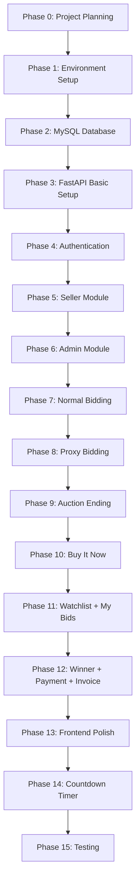

# Implementation Plan — Auction Bidding Platform (University Semester Project)

## Project Overview

This implementation plan defines the phase-by-phase development roadmap for a **university-level Auction Bidding Platform**. The project focuses on practical understanding of full-stack development, database management, REST APIs, authentication, and core auction logic — without unnecessary production-level complexity.

---

## Final Technology Stack

* **Frontend:** HTML + CSS + JavaScript (Bootstrap optional)
* **Backend:** Python + FastAPI
* **Database:** MySQL
* **ORM:** SQLAlchemy
* **Authentication:** JWT + Password Hashing (bcrypt)
* **Optional (if time permits):** WebSocket for real-time bid updates

### Architecture Flow

```
User (Browser)
     ↓
HTML + CSS + JavaScript
     ↓
FastAPI Backend (Python)
     ↓
SQLAlchemy ORM
     ↓
MySQL Database
```

**NOT using:** React, PostgreSQL, Docker, Kubernetes, Redis, Celery, Microservices, or any cloud infrastructure.

---

## 16-Phase Development Roadmap



---

## Phase Details

### Phase 0 — Project Planning (Day 1)
* Finalise all features, user roles, database tables, pages, and API list.
* Confirm three roles: Admin, Seller, Bidder.
* Define the core flow: Register/Login → Seller creates auction → Admin approves → Auction active → Bidder bids → Highest bidder wins → Payment → Invoice.

---

### Phase 1 — Environment Setup (Days 2–3)
* Install Python, VS Code, MySQL, MySQL Workbench, Git.
* Create project directory structure:

```
auction-platform/
├── backend/
│   ├── venv/
│   ├── main.py
│   ├── requirements.txt
│   └── app/
├── frontend/
├── database/
└── README.md
```

* Set up Python virtual environment and install FastAPI, SQLAlchemy, PyMySQL, python-jose, passlib.
* Learn required Python basics: functions, classes, dictionaries, lists, exceptions, modules.

---

### Phase 2 — MySQL Database (Days 4–7)
* Design and create all database tables in MySQL.
* **Start with core tables:** `users`, `categories`, `auctions`, `bids`.
* **Then add:** `proxy_bids`, `watchlist`, `won_auctions`, `invoices`.
* Learn and practice: CREATE TABLE, INSERT, SELECT, UPDATE, DELETE, PRIMARY KEY, FOREIGN KEY, JOIN, UNIQUE.
* Understand the ER relationships:
  * User → Seller → Auctions → Bids
  * User → Bidder → Bids, Proxy Bids, Watchlist

#### Database Tables

* **users:** id, name, email, password, role, created_at
* **categories:** id, name
* **auctions:** id, seller_id, category_id, title, description, condition, image, starting_bid, current_bid, minimum_increment, reserve_price, buy_it_now_price, start_time, end_time, status, created_at
* **bids:** id, auction_id, bidder_id, amount, bid_type, created_at
* **proxy_bids:** id, auction_id, bidder_id, max_amount, created_at
* **watchlist:** id, auction_id, bidder_id, created_at
* **won_auctions:** id, auction_id, bidder_id, winning_amount, payment_status, delivery_address, created_at
* **invoices:** id, won_auction_id, invoice_number, amount, created_at

---

### Phase 3 — FastAPI Basic Setup (Days 8–10)
* Create FastAPI application with basic routes.
* Build first test endpoints: `GET /`, `GET /auctions`, `GET /auctions/{id}`.
* Connect FastAPI to MySQL using SQLAlchemy.
* Learn: Routes, Request/Response, Path Parameters, Query Parameters, Pydantic models.

---

### Phase 4 — Authentication (Days 11–14)
* Build `POST /register` and `POST /login` endpoints.
* Implement password hashing using bcrypt (passlib).
* Generate JWT tokens on login.
* Add role-based access control middleware.
* Login flow: Login → JWT Token → Role check (Admin / Seller / Bidder) → Redirect to appropriate dashboard.

---

### Phase 5 — Seller Module (Days 15–19)
* Build Seller Dashboard page.
* Create Auction form with fields: Title, Description, Category, Condition, Image, Starting Bid, Minimum Increment, Reserve Price (optional), Buy-It-Now Price (optional), Start Time, End Time.
* APIs: `POST /auctions`, `GET /seller/auctions`, `GET /auctions/{id}`, `PUT /auctions/{id}`.
* New auctions start in `draft` or `pending` status.

---

### Phase 6 — Admin Module (Days 20–22)
* Build Admin Dashboard with stats: Total users, sellers, bidders, auctions, active/ended counts.
* Implement auction approval flow: Seller creates → Pending → Admin Approves/Rejects → Active.
* Manage Categories: Add, Edit, Delete.
* APIs: `GET /admin/auctions`, `PUT /admin/auctions/{id}/approve`, `PUT /admin/auctions/{id}/reject`.

---

### Phase 7 — Normal Bidding ⭐ (Days 23–27)
**This is the most important module of the project.**

* Build bid placement endpoint: `POST /auctions/{id}/bid`.
* Validate: `new_bid >= current_bid + minimum_increment`.
* Update auction's `current_bid` and track highest bidder.
* Append every bid to the `bids` table (append-only log).
* Learn basics of SQL transactions, database locking, and `SELECT FOR UPDATE` to handle race conditions.
* Reject bids on: ended auctions, own auctions (seller cannot bid), amounts below minimum.

---

### Phase 8 — Proxy Bidding ⭐ (Days 28–31)
* Build `POST /auctions/{id}/proxy-bid` endpoint.
* Bidder sets a secret `max_amount` — never shown to other users.
* When another bidder places a manual bid, system checks for active proxy bids and automatically counter-bids at `(new_bid + minimum_increment)` up to the proxy holder's max.
* If proxy max is exceeded, the manual bidder wins.
* Store proxy bids in `proxy_bids` table with UNIQUE(auction_id, bidder_id) constraint.

---

### Phase 9 — Auction Ending ⭐ (Days 32–34)
* Implement a background checker that monitors auctions where `current_time >= end_time`.
* When auction ends: stop accepting bids, identify highest bidder.
* Reserve price check: If `highest_bid >= reserve_price` → status = `sold`. If `highest_bid < reserve_price` → status = `unsold`.
* If no bids placed → status = `ended`.
* Create `won_auctions` record for the winner.

---

### Phase 10 — Buy It Now (Days 35–36)
* If an auction has a `buy_it_now_price`, display a "Buy It Now" button.
* When clicked: Auction ends immediately, bidder becomes the winner.
* Create `won_auctions` record with the BIN price as winning amount.

---

### Phase 11 — Watchlist + My Bids (Days 37–39)
* **My Bids Dashboard:** Show all auctions where the bidder has placed bids, with: Auction title, My bid, Current highest bid, Status (Winning / Outbid / Won / Lost).
* **Watchlist:** Bidder can add/remove auctions to watchlist. View: Auction title, Current bid, Time remaining, Status.
* APIs: `POST /watchlist`, `GET /watchlist`, `DELETE /watchlist/{id}`, `GET /bidder/my-bids`.

---

### Phase 12 — Winner + Payment + Invoice (Days 40–42)
* After winning, bidder can: View won auction details, Enter delivery address, Make simulated payment (no real gateway — just status update to "Paid"), View/download invoice.
* Invoice contains: Invoice Number, Auction title, Product, Winner name, Winning amount, Date.
* Payment is simulated — just `Pending` → `Paid` status change.

---

### Phase 13 — Frontend Polish (Days 43–47)
* Connect all frontend pages properly to backend APIs using JavaScript `fetch()`.
* **Pages to build:**
  * Public: Home, Login, Register, Auction List, Auction Details.
  * Bidder: My Bids, Watchlist, Won Auctions, Payment page.
  * Seller: Dashboard, Create Auction, My Auctions.
  * Admin: Dashboard, Manage Users, Manage Categories, Auction Approval.
* Add navbar, search, category filter, auction cards, bid history display.

---

### Phase 14 — Countdown Timer (Day 48)
* JavaScript countdown timer on Auction Detail page showing `HH : MM : SS` remaining.
* Timer updates every second using `setInterval()`.
* When timer reaches zero, display "AUCTION ENDED".

---

### Phase 15 — Testing (Days 49–53)
* Test every feature systematically:
  * **Authentication:** Correct login → success; wrong password → error; seller accessing admin → rejected.
  * **Auction:** Valid auction → created; invalid price → rejected.
  * **Bidding:** Valid bid → accepted; low bid → rejected; seller bids own item → rejected; bid on ended auction → rejected.
  * **Proxy:** Proxy max > new bid → auto bid; proxy max exceeded → other bidder wins.
  * **Winner:** Auction ends → highest bidder → winner record created.
* Fix all bugs and edge cases.

---

## MVP Priority Order

### Must Have ⭐⭐⭐ (Complete First)
* Register & Login
* Admin / Seller / Bidder roles
* Seller create auction
* Admin approve auction
* Browse auctions
* Auction details page
* Normal bidding with minimum bid validation
* Highest bidder tracking
* Auction ending & winner determination
* My Bids dashboard

### Then Add ⭐⭐
* Proxy bidding
* Buy It Now
* Watchlist
* Payment simulation
* Invoice generation

### Optional / Last ⭐
* Auto-extension (anti-sniping)
* WebSocket real-time bid updates
* Seller ratings
* Advanced analytics

---

## Verification Plan

### After Each Phase
* Run the backend server and test all new API endpoints.
* Verify database records are created correctly in MySQL Workbench.
* Test frontend pages connect to backend properly.

### Final Testing (Phase 15)
* Complete end-to-end flow: Register → Login → Create Auction → Approve → Bid → Win → Pay → Invoice.
* Test proxy bidding scenarios with multiple bidders.
* Test edge cases: expired auctions, reserve not met, Buy It Now.

---

## Suggested Semester Timeline

* **Week 1:** Requirements + Python basics + Project setup
* **Week 2:** MySQL + Database tables + Relationships
* **Week 3:** FastAPI + SQLAlchemy connection
* **Week 4:** Register / Login + JWT + Roles
* **Week 5:** Seller + Create Auction
* **Week 6:** Admin + Auction Approval
* **Week 7:** Normal Bidding ⭐
* **Week 8:** Bid validation + Concurrency basics ⭐
* **Week 9:** Proxy Bidding
* **Week 10:** Auction Ending + Winner
* **Week 11:** Watchlist + My Bids + Buy It Now
* **Week 12:** Payment + Invoice
* **Week 13:** Frontend polishing + Countdown timer
* **Week 14:** Testing + Bug fixing
* **Week 15:** Documentation + PPT + Viva preparation

**Most important rule:** First build a working project → then add extra features.
