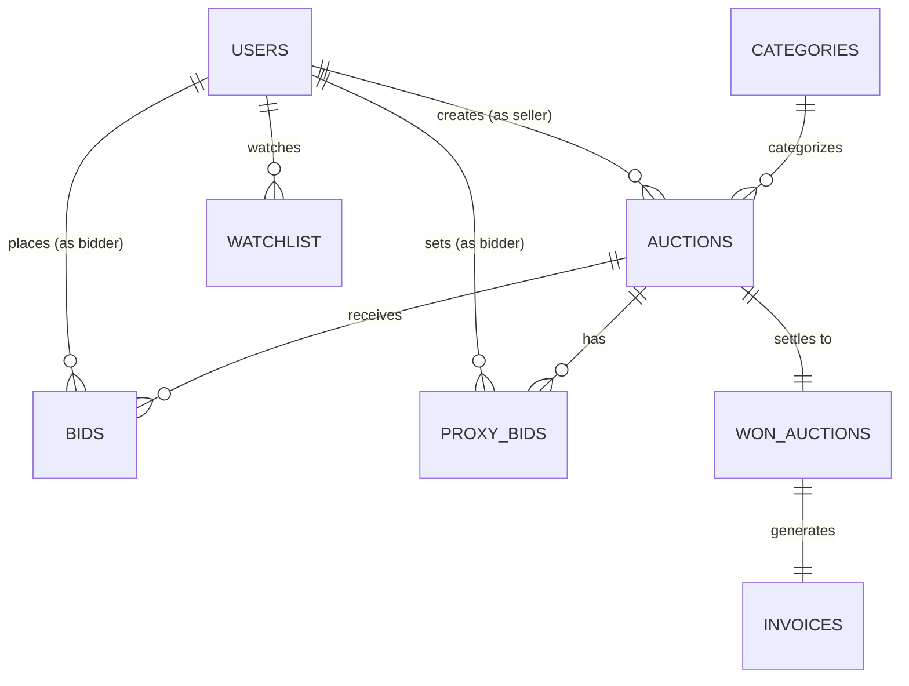

# ACADEMIC PROJECT SYNOPSIS

## AUCTION BIDDING PLATFORM
**Project Type:** University Semester Project
**Domain:** Full-Stack Web Development & Database Management
**Tech Stack:** Python (FastAPI) / MySQL / HTML, CSS, JavaScript

---

### STUDENT & INSTITUTION DETAILS
* **Project Title:** Auction Bidding Platform
* **Student Name:** Mandeep
* **Roll / Registration No:** 2415500535

---

## 1. ABSTRACT

The Auction Bidding Platform is a web-based full-stack application where sellers can create time-limited auctions for their products and registered bidders can participate by placing competitive bids. The system supports three user roles — Admin, Seller, and Bidder - each with distinct permissions and dashboards.

The platform implements core auction mechanics including manual bidding with minimum increment validation, proxy (automatic) bidding where the system bids on behalf of users up to their secret maximum limit, Buy-It-Now instant purchase, watchlist tracking, automated winner determination when auctions expire, and simulated payment with invoice generation.

The project is designed as a university semester project focusing on practical understanding of full-stack development, relational database management, RESTful API design, JWT authentication, and fundamental auction bidding logic.

---

## 2. INTRODUCTION & BACKGROUND

Online auction platforms enable competitive price discovery by allowing multiple buyers to bid against each other within a time-limited window. Unlike standard e-commerce where items have fixed prices, auctions require dynamic pricing, real-time bid validation, and automated end-of-auction settlement.

This project builds a simplified auction marketplace that captures the essential engineering patterns of platforms like eBay and government e-procurement portals, while maintaining a complexity level appropriate for a university semester project.

### Key Concepts Implemented
* **Manual Bidding:** Users place bids that must exceed the current highest bid plus a minimum increment.
* **Proxy Bidding:** Users set a secret maximum budget; the system automatically counter-bids on their behalf when outbid, up to their limit.
* **Buy-It-Now:** Optional instant purchase at a fixed price, ending the auction immediately.
* **Reserve Price:** A hidden minimum price set by the seller; if the highest bid does not meet the reserve, the item remains unsold.
* **Winner Determination:** When an auction's end time is reached, the system identifies the highest bidder, checks the reserve price, and creates a winner record.

---

## 3. PROBLEM STATEMENT

Standard web applications are not designed to handle the unique requirements of auction systems:
* Bids must be validated in real-time against the current highest bid and minimum increment rules.
* Multiple users may attempt to bid simultaneously, requiring basic concurrency handling.
* Proxy bids must remain secret and the system must automatically advance them when competing bids arrive.
* Auctions must close automatically at the scheduled end time, with correct winner identification.

---

## 4. PROJECT OBJECTIVES

1. Build a complete full-stack web application with three user roles (Admin, Seller, Bidder).
2. Implement auction listing creation with configurable pricing (starting bid, minimum increment, reserve price, Buy-It-Now).
3. Implement manual bidding with proper validation (amount >= current_bid + minimum_increment).
4. Implement proxy bidding where the system secretly auto-bids on behalf of users up to their maximum.
5. Implement automated auction ending with winner determination and reserve price checking.
6. Build a simulated payment and invoice generation flow for winning bidders.
7. Provide an admin panel for listing approval, category management, and basic platform statistics.

---

## 5. PROJECT SCOPE

### In-Scope
* User registration and login with JWT authentication
* Role-based access control (Admin, Seller, Bidder)
* Auction listing creation and admin approval workflow
* Manual bidding with increment validation
* Proxy bidding with secret max amounts
* Buy-It-Now instant purchase
* Watchlist for bidders
* My Bids dashboard with Winning/Outbid status
* Auction ending and winner determination
* Simulated payment and invoice generation
* Responsive web frontend

### Out-of-Scope (Future Work)
* Real payment gateway integration (Stripe, Razorpay)
* WebSocket real-time updates (can be added later)
* Mobile application
* Docker / Kubernetes deployment
* AI/ML-based recommendations
* Advanced analytics dashboards

---

## 6. SYSTEM ARCHITECTURE

```
User (Web Browser)
       ↓
HTML + CSS + JavaScript (Frontend)
       ↓
FastAPI Backend (Python REST API)
       ↓
SQLAlchemy ORM
       ↓
MySQL Database
```

The architecture is a simple client-server model:
1. The frontend makes HTTP requests (using JavaScript `fetch()`) to the FastAPI backend.
2. The backend validates requests, checks authentication, processes business logic, and interacts with MySQL.
3. Responses are returned as JSON and rendered by the frontend.

---

## 7. DATABASE DESIGN

The database uses MySQL with the following entities:



### Entity Definitions

* **users:** id, name, email, password (hashed), role (admin/seller/bidder), created_at
* **categories:** id, name
* **auctions:** id, seller_id, category_id, title, description, condition, image, starting_bid, current_bid, minimum_increment, reserve_price, buy_it_now_price, start_time, end_time, status, created_at
* **bids:** id, auction_id, bidder_id, amount, bid_type (manual/proxy_auto), created_at — Append-only log.
* **proxy_bids:** id, auction_id, bidder_id, max_amount (secret), created_at — UNIQUE(auction_id, bidder_id).
* **watchlist:** id, auction_id, bidder_id, created_at
* **won_auctions:** id, auction_id, bidder_id, winning_amount, payment_status, delivery_address, created_at
* **invoices:** id, won_auction_id, invoice_number, amount, created_at

---

## 8. EXPECTED OUTCOME

The final system shall allow the complete auction lifecycle:

```
Seller → Create Auction → Admin Approval → Auction Goes Live
  ↓
Bidders Browse & Place Bids → Proxy Bidding Competition
  ↓
Auction Ends → Highest Bidder Wins
  ↓
Simulated Payment → Invoice Generated
```

The project demonstrates practical understanding of: Python, FastAPI, MySQL, REST APIs, JWT Authentication, Database relationships, Auction bidding logic, and Frontend-backend integration.

---

## 9. FUTURE SCOPE

* **Real-time Updates:** WebSocket integration for instant bid notifications.
* **Payment Gateway:** Stripe / Razorpay integration for real transactions.
* **Mobile App:** Native Android/iOS app using the existing REST API.
* **AI Features:** Price prediction and auto-generated product descriptions.
* **Auto-Extension:** Anti-sniping clock extension when bids arrive near auction end.

---