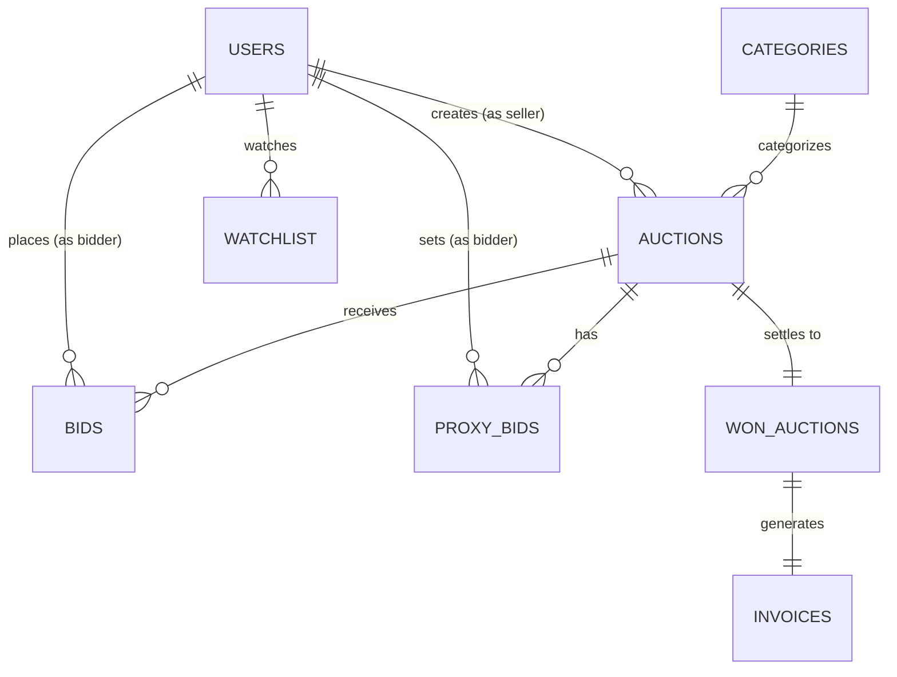

# ACADEMIC PROJECT SYNOPSIS

## AUCTION BIDDING PLATFORM
**Project Type:** University Semester Project
**Domain:** Full-Stack Web Development & Database Management
**Tech Stack:** Python (FastAPI) / MySQL / HTML, CSS, JavaScript

---

### STUDENT & INSTITUTION DETAILS
* **Project Title:** Auction Bidding Platform
* **Student Name:** [Your Name]
* **Roll / Registration No:** [Your Roll Number]
* **Degree / Course:** B.Tech / B.E. / M.Tech in Computer Science & Engineering
* **Department:** Department of Computer Science & Engineering
* **Institution Name:** [Your College / University Name]
* **Academic Year:** 2025 – 2026
* **Guide / Supervisor:** [Supervisor / Instructor Name]

---

## 1. ABSTRACT

The Auction Bidding Platform is a web-based full-stack application where sellers can create time-limited auctions for their products and registered bidders can participate by placing competitive bids. The system supports three user roles — Admin, Seller, and Bidder — each with distinct permissions and dashboards.

The platform implements core auction mechanics including manual bidding with minimum increment validation, proxy (automatic) bidding where the system bids on behalf of users up to their secret maximum limit, Buy-It-Now instant purchase, watchlist tracking, automated winner determination when auctions expire, and simulated payment with invoice generation.

The project is designed as a university semester project focusing on practical understanding of full-stack development, relational database management, RESTful API design, JWT authentication, and fundamental auction bidding logic.

---

## 2. INTRODUCTION & BACKGROUND

Online auction platforms enable competitive price discovery by allowing multiple buyers to bid against each other within a time-limited window. Unlike standard e-commerce where items have fixed prices, auctions require dynamic pricing, real-time bid validation, and automated end-of-auction settlement.

This project builds a simplified auction marketplace that captures the essential engineering patterns of platforms like eBay and government e-procurement portals, while maintaining a complexity level appropriate for a university semester project.

### Key Concepts Implemented
* **Manual Bidding:** Users place bids that must exceed the current highest bid plus a minimum increment.
* **Proxy Bidding:** Users set a secret maximum budget; the system automatically counter-bids on their behalf when outbid, up to their limit.
* **Buy-It-Now:** Optional instant purchase at a fixed price, ending the auction immediately.
* **Reserve Price:** A hidden minimum price set by the seller; if the highest bid does not meet the reserve, the item remains unsold.
* **Winner Determination:** When an auction's end time is reached, the system identifies the highest bidder, checks the reserve price, and creates a winner record.

---

## 3. PROBLEM STATEMENT

Standard web applications are not designed to handle the unique requirements of auction systems:
* Bids must be validated in real-time against the current highest bid and minimum increment rules.
* Multiple users may attempt to bid simultaneously, requiring basic concurrency handling.
* Proxy bids must remain secret and the system must automatically advance them when competing bids arrive.
* Auctions must close automatically at the scheduled end time, with correct winner identification.

This project addresses these challenges using database transactions, bid validation logic, and a background task for auction closure — all at a level appropriate for a university semester project.

---

## 4. PROJECT OBJECTIVES

1. Build a complete full-stack web application with three user roles (Admin, Seller, Bidder).
2. Implement auction listing creation with configurable pricing (starting bid, minimum increment, reserve price, Buy-It-Now).
3. Implement manual bidding with proper validation (amount >= current_bid + minimum_increment).
4. Implement proxy bidding where the system secretly auto-bids on behalf of users up to their maximum.
5. Implement automated auction ending with winner determination and reserve price checking.
6. Build a simulated payment and invoice generation flow for winning bidders.
7. Provide an admin panel for listing approval, category management, and basic platform statistics.

---

## 5. PROJECT SCOPE

### In-Scope
* User registration and login with JWT authentication
* Role-based access control (Admin, Seller, Bidder)
* Auction listing creation and admin approval workflow
* Manual bidding with increment validation
* Proxy bidding with secret max amounts
* Buy-It-Now instant purchase
* Watchlist for bidders
* My Bids dashboard with Winning/Outbid status
* Auction ending and winner determination
* Simulated payment and invoice generation
* Responsive web frontend

### Out-of-Scope (Future Work)
* Real payment gateway integration (Stripe, Razorpay)
* WebSocket real-time updates (can be added later)
* Mobile application
* Docker / Kubernetes deployment
* AI/ML-based recommendations
* Advanced analytics dashboards

---

## 6. TECHNOLOGY STACK

* **Backend Framework:** FastAPI (Python 3.10+)
  * Rationale: Lightweight, fast, automatic API documentation via Swagger UI.
* **Database:** MySQL with InnoDB engine
  * Rationale: Widely taught in university curriculum, supports transactions and foreign keys.
* **ORM:** SQLAlchemy 2.0
  * Rationale: Python-native ORM supporting database queries, relationships, and transactions.
* **Frontend:** HTML5 + CSS3 + JavaScript (Bootstrap optional)
  * Rationale: Simple, no build tools required, easy to understand and deploy.
* **Authentication:** JWT (JSON Web Tokens) with bcrypt password hashing
  * Rationale: Stateless authentication suitable for REST APIs.

### Hardware Requirements
* Processor: Dual-core 2.0 GHz or higher
* RAM: Minimum 4 GB
* Disk Space: 500 MB

---

## 7. SYSTEM ARCHITECTURE

```
User (Web Browser)
       ↓
HTML + CSS + JavaScript (Frontend)
       ↓
FastAPI Backend (Python REST API)
       ↓
SQLAlchemy ORM
       ↓
MySQL Database
```

The architecture is a simple client-server model:
1. The frontend makes HTTP requests (using JavaScript `fetch()`) to the FastAPI backend.
2. The backend validates requests, checks authentication, processes business logic, and interacts with MySQL.
3. Responses are returned as JSON and rendered by the frontend.

---

## 8. MODULE DESCRIPTIONS

1. **Authentication Module:** Handles user registration, bcrypt password hashing, JWT token generation, and role-based access control.

2. **Seller Module:** Allows sellers to create auction listings with all pricing fields, view their own auctions, and track auction results.

3. **Admin Module:** Provides admin dashboard with platform statistics, category management, and auction listing approval/rejection workflow.

4. **Bidding Module:** Processes manual bids with validation (amount >= current_bid + increment), updates auction's current bid, and maintains the append-only bids log.

5. **Proxy Bidding Module:** Stores secret maximum bids per bidder per auction. Automatically counter-bids when a competing manual bid arrives, up to the proxy holder's maximum.

6. **Buy-It-Now Module:** Enables instant purchase at the BIN price, immediately closing the auction and creating a winner record.

7. **Auction Ending Module:** Background checker that identifies expired auctions, determines the winner, checks reserve prices, and updates auction status.

8. **Payment & Invoice Module:** Simulated payment flow (Pending → Paid) and invoice generation for winning bidders.

9. **Watchlist & My Bids Module:** Allows bidders to track auctions of interest and view all their active bids with status badges (Winning / Outbid / Won / Lost).

---

## 9. DATABASE DESIGN

The database uses MySQL with the following entities:



### Entity Definitions

* **users:** id, name, email, password (hashed), role (admin/seller/bidder), created_at
* **categories:** id, name
* **auctions:** id, seller_id, category_id, title, description, condition, image, starting_bid, current_bid, minimum_increment, reserve_price, buy_it_now_price, start_time, end_time, status, created_at
* **bids:** id, auction_id, bidder_id, amount, bid_type (manual/proxy_auto), created_at — Append-only log.
* **proxy_bids:** id, auction_id, bidder_id, max_amount (secret), created_at — UNIQUE(auction_id, bidder_id).
* **watchlist:** id, auction_id, bidder_id, created_at
* **won_auctions:** id, auction_id, bidder_id, winning_amount, payment_status, delivery_address, created_at
* **invoices:** id, won_auction_id, invoice_number, amount, created_at

---

## 10. CORE ALGORITHM — BID PLACEMENT

```python
def place_bid(auction_id, bidder_id, bid_amount):
    # Step 1: Fetch the auction
    auction = get_auction(auction_id)
    
    # Step 2: Validate auction is active and not expired
    if auction.status != 'active' or now() > auction.end_time:
        return Error("Auction is not active or has ended")
    
    # Step 3: Seller cannot bid on own auction
    if auction.seller_id == bidder_id:
        return Error("Cannot bid on your own auction")
    
    # Step 4: Validate minimum bid amount
    min_required = auction.current_bid + auction.minimum_increment
    if bid_amount < min_required:
        return Error(f"Minimum bid is {min_required}")
    
    # Step 5: Record the bid
    create_bid(auction_id, bidder_id, bid_amount, type='manual')
    
    # Step 6: Update auction current bid
    auction.current_bid = bid_amount
    
    # Step 7: Check proxy bids from other bidders
    best_proxy = get_highest_active_proxy(auction_id, exclude=bidder_id)
    if best_proxy and best_proxy.max_amount > bid_amount:
        auto_amount = min(best_proxy.max_amount, bid_amount + auction.minimum_increment)
        create_bid(auction_id, best_proxy.bidder_id, auto_amount, type='proxy_auto')
        auction.current_bid = auto_amount
        return {"status": "outbid_by_proxy", "current_bid": auto_amount}
    
    return {"status": "winning", "current_bid": bid_amount}
```

---

## 11. TESTING PLAN

* **Test 1 — Authentication:** Correct login succeeds; wrong password returns error; seller cannot access admin endpoints.
* **Test 2 — Auction Creation:** Valid auction created successfully; invalid price rejected.
* **Test 3 — Bidding:** Valid bid accepted; bid below minimum rejected; seller bidding on own auction rejected; bid on ended auction rejected.
* **Test 4 — Proxy Bidding:** Proxy max > competing bid → system auto-bids; proxy max exceeded → competing bidder wins.
* **Test 5 — Auction Ending:** Auction ends at scheduled time; highest bidder identified; reserve not met → no sale.
* **Test 6 — Payment & Invoice:** Winner can simulate payment; invoice generated with correct details.

---

## 12. FEASIBILITY STUDY

1. **Technical Feasibility:** Fully feasible using open-source, free tools (Python, FastAPI, MySQL, HTML/CSS/JS). All technologies are well-documented and widely used in university curricula.
2. **Operational Feasibility:** The system automates bid validation and winner determination, reducing manual effort.
3. **Economic Feasibility:** Zero cost — all technologies are free and open-source.

---

## 13. EXPECTED OUTCOME

The final system shall allow the complete auction lifecycle:

```
Seller → Create Auction → Admin Approval → Auction Goes Live
  ↓
Bidders Browse & Place Bids → Proxy Bidding Competition
  ↓
Auction Ends → Highest Bidder Wins
  ↓
Simulated Payment → Invoice Generated
```

The project demonstrates practical understanding of: Python, FastAPI, MySQL, REST APIs, JWT Authentication, Database relationships, Auction bidding logic, and Frontend-backend integration.

---

## 14. FUTURE SCOPE

* **Real-time Updates:** WebSocket integration for instant bid notifications.
* **Payment Gateway:** Stripe / Razorpay integration for real transactions.
* **Mobile App:** Native Android/iOS app using the existing REST API.
* **AI Features:** Price prediction and auto-generated product descriptions.
* **Auto-Extension:** Anti-sniping clock extension when bids arrive near auction end.

---

## 15. REFERENCES

1. FastAPI Documentation: https://fastapi.tiangolo.com/
2. MySQL Documentation: https://dev.mysql.com/doc/
3. SQLAlchemy Documentation: https://docs.sqlalchemy.org/
4. MDN Web Docs — JavaScript Fetch API: https://developer.mozilla.org/en-US/docs/Web/API/Fetch_API
5. InterviewCafe Project Specification Guide (Project #29: Auction Platform).
